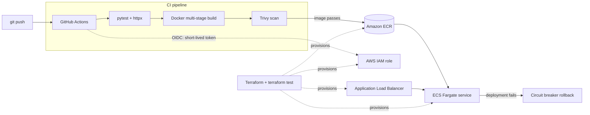
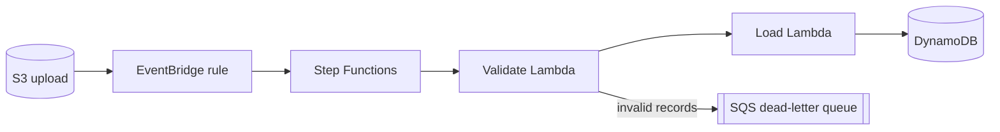

<h1 align="center">Hi, I'm Masego 👋</h1>
<h3 align="center">Cloud & DevOps Engineer · AWS · Terraform · CI/CD · ZA 📍</h3>

  

  
  

---

## 💫 About Me

I'm a Cloud & DevOps Engineer with a background in Systems Engineering, Information Systems, Computer Science and BI. I build AWS infrastructure entirely as code (Terraform), ship services through pipelines that test, scan and deploy on every push, and design for failure from the start: automated rollback, dead-letter queues, and audit logging are defaults, not extras.

Every project I build ships with the same engineering artefacts a production team would expect: an architecture diagram, **Architecture Decision Records (ADRs)** explaining the trade-offs, a **runbook** for operating it, automated tests, and a **teardown script** so nothing is left running and costing money. Systems engineering taught me to reason about the whole system — components, failure modes, security boundaries, and the people who will operate it after me.

> *"I don't just write code — I deliver working, documented, operable systems."*
>
> 👉 **See the proof:** six AWS projects in **[Discovering-Cloud-Engineering](https://github.com/masegoleroux-commits/Discovering-Cloud-Engineering)**

---

## 🧭 Engineering Principles

| Principle | How it shows up in my work |
|---|---|
| **Everything as code** | All infrastructure provisioned with Terraform; no console click-ops. State and variable files are kept out of Git. |
| **Shift-left security** | Container images scanned with Trivy in CI before they reach ECR. CI authenticates to AWS through **OIDC federation**, so no long-lived access keys exist to leak. |
| **Design for failure** | ECS deployment circuit breaker rolls back bad releases automatically. Pipelines route bad records to an SQS dead-letter queue instead of dropping them. |
| **Test at every layer** | Unit tests with pytest, AWS services mocked with moto, API tests with httpx, and infrastructure tests with native `terraform test`. |
| **Operability is part of done** | Each project has a runbook, ADRs, and architecture diagrams, so someone else can run it without me. |
| **Cost awareness** | Every environment has a teardown path; resources are destroyed after verification and evidence is kept as screenshots. |

---

## 🎯 What I'm Working On

- ☁️ **Multi-cloud:** porting my AWS patterns to **Azure** (Terraform + GitHub Actions OIDC to Azure)
- 🤖 **MLOps:** deploying and monitoring models in production behind the same tested, scanned CI/CD pipelines
- 📊 **Data platform:** building toward **Microsoft PL-300**, with **DP-600** and **DP-700** (Microsoft Fabric) on the roadmap
- 🏗️ **Domain projects:** end-to-end builds on real sports and business datasets

---

## 💡 Core Skills

| Area | Tools & Technologies |
|---|---|
| **Cloud (AWS)** | Compute: Lambda, EC2, ECS Fargate · Networking: VPC, ALB, API Gateway · Data: S3, DynamoDB · Orchestration & events: Step Functions, EventBridge, SQS · Security & governance: IAM (OIDC), CloudTrail, AWS Config, SSM · Registry: ECR |
| **Infrastructure as Code** | Terraform (modules, variables/outputs, native `terraform test`, `terraform validate` in CI) |
| **CI/CD & Containers** | GitHub Actions · Docker (multi-stage builds on `python:3.12-slim`) · Trivy image scanning · OIDC federation to AWS |
| **Software Development** | Python (FastAPI, boto3) · SQL · Bash · C# · Java · C++ · HTML5 |
| **Testing** | pytest · moto (AWS mocking) · httpx · `terraform test` |
| **Databases** | DynamoDB · MS SQL Server (T-SQL) · PostgreSQL · MySQL · MongoDB · Firebase |
| **Data & BI** | ETL/ELT pipeline design · pandas · scikit-learn · Apache Airflow · Power BI (DAX, semantic modelling) · Azure Data Factory · Microsoft Fabric |
| **Engineering Practice** | ADRs · runbooks · architecture diagrams (draw.io) · requirements gathering · stakeholder communication |

### 🚀 Currently Expanding Into
Azure · Kubernetes · Observability (dashboards & alerting) · LLM integration · Agile/Scrum with Jira

---

## 🏆 Highlights for Hiring Managers

- ✅ **Secure delivery pipeline** — test → build → Trivy scan → push to ECR → deploy to ECS Fargate, authenticated with OIDC (zero stored AWS credentials), with automatic rollback on failed deployments
- ✅ **Event-driven architecture** — S3 → EventBridge → Step Functions orchestration with separate validate and load stages, and a dead-letter queue for failed records
- ✅ **Infrastructure tested like application code** — `terraform validate` and `terraform test` run alongside pytest suites in CI
- ✅ **Governance from day one** — CloudTrail audit logging and AWS Config compliance rules, with real non-compliance findings captured and documented
- ✅ **Documented decisions** — ADRs and runbooks for every project, written for the engineer who operates it next
- ✅ **Currently available** for Cloud Engineer, DevOps Engineer, Software Developer, and AI Software Engineer roles in Johannesburg or remote

---

## 🗂️ Featured Projects

> ✅ *All six projects are built, verified, documented, and torn down, with architecture notes, ADRs, runbooks, and screenshots in **[Discovering-Cloud-Engineering](https://github.com/masegoleroux-commits/Discovering-Cloud-Engineering)**.*

---

### 🚢 Containerised API with Secure CI/CD on ECS Fargate

**Problem:** ship a containerised service to AWS on every push without storing cloud credentials in CI, without letting vulnerable images reach production, and without a bad release taking the service down.

**Architecture:**

| Decision | Why |
|---|---|
| **OIDC federation** instead of IAM access keys | CI gets short-lived credentials per run; there is no secret to rotate or leak |
| **Trivy scan as a pipeline gate** | Vulnerabilities are caught before the image is pushed, not after it is running |
| **Multi-stage Docker build** on a slim base | Smaller image, smaller attack surface, faster deploys |
| **ECS Fargate** over EC2 | No servers to patch; the team manages tasks, not hosts |
| **Deployment circuit breaker** | A failed release rolls back automatically — verified and captured in screenshots |
| **`terraform test`** for the CI auth setup | The IAM/OIDC trust configuration is tested like code, because a mistake there is a security issue |

**Stack:** Python · FastAPI · Docker · Trivy · GitHub Actions · AWS (ECS Fargate, ECR, ALB, IAM) · Terraform

> 📁 *[View project, ADRs and runbook](https://github.com/masegoleroux-commits/Discovering-Cloud-Engineering/tree/main/cloud-pro_5/05-ecs-fargate-cicd)*

---

### 🔄 Event-Driven CSV Data Pipeline

**Problem:** ingest CSV files reliably as they arrive, reject bad data without losing it, and make every step of processing visible.

| Decision | Why |
|---|---|
| **Event-driven** (S3 → EventBridge) instead of polling | Processing starts when data lands; nothing runs or costs money while idle |
| **Step Functions** to orchestrate separate validate and load stages | Each stage is small and testable, and the state machine shows exactly where a run failed |
| **Dead-letter queue** for failures | Bad data is kept for inspection and replay rather than silently dropped |
| **moto** for tests | AWS calls are tested locally in CI without deploying anything |

**Stack:** AWS (S3, EventBridge, Step Functions, Lambda, DynamoDB, SQS) · Python (boto3) · pytest · moto · Terraform · GitHub Actions

> 📁 *[View project](https://github.com/masegoleroux-commits/Discovering-Cloud-Engineering/tree/main/cloud-pro_6/06-event-driven-csv-pipeline)*

---

### ⚡ Serverless Notes API

**Problem:** a REST API with no servers to manage, that scales to zero when idle.

**Design:** API Gateway → Lambda (Python) → DynamoDB, provisioned in Terraform. CI runs the pytest suite and `terraform validate` on every push, so broken code or invalid infrastructure never merges.

**Stack:** AWS (API Gateway, Lambda, DynamoDB) · Python · pytest · Terraform · GitHub Actions

> 📁 *[View project](https://github.com/masegoleroux-commits/Discovering-Cloud-Engineering/tree/main/cloud-pro_3)*

---

### 🛡️ Platform & Security Foundations

| Project | Technical focus | Link |
|---|---|---|
| **VPC + Hardened Web Server** | Custom VPC network design, EC2 hardening, administrative access through SSM Session Manager | [View](https://github.com/masegoleroux-commits/Discovering-Cloud-Engineering/tree/main/cloud-pro_4) |
| **AWS Security Baseline** | CloudTrail audit logging, AWS Config managed rules, non-compliance findings documented | [View](https://github.com/masegoleroux-commits/Discovering-Cloud-Engineering/tree/main/cloud-pro_7) |
| **Static Website on S3** | S3 static hosting, Terraform fundamentals | [View](https://github.com/masegoleroux-commits/Discovering-Cloud-Engineering/tree/main/cloud-pro_1) |
| **UCL 2021/22 SQL Analysis** | T-SQL analysis of Champions League data on SQL Server | [View](https://github.com/masegoleroux-commits/SQL_Boulevard) |

---

### 🔜 Coming Next

- ☁️ **Azure port** — the event-driven pipeline rebuilt on Azure (Blob Storage → Event Grid → Functions) with Terraform and GitHub Actions OIDC
- 📊 **Sports Analytics & AI Platform** — PostgreSQL warehouse, scikit-learn models, and Power BI dashboards for coaching, sports science, scouting, and commercial teams
- ☁️ **Cloud Business Reporting Solution** — SQL Server → Azure Data Factory → Power BI semantic model with automated daily refresh
- 🔄 **Airflow ETL Pipeline** — scheduled CSV loads into PostgreSQL with data quality checks, Docker, and GitHub Actions

---

## 💻 Tech Stack

**Cloud, IaC & DevOps**

**Languages & Frameworks**

**Testing**

**Data & AI**

**Databases**

**Version Control & Project Management**

---

## 🤝 Let's Work Together

I also take on **freelance projects**:

- ☁️ **AWS infrastructure as code** — Terraform-managed environments that are reproducible and reviewable
- 🔁 **CI/CD pipelines** — GitHub Actions with automated tests, image scanning, and keyless (OIDC) cloud deployments
- 🔄 **Event-driven data pipelines** — serverless ingestion, validation, and loading with failure handling built in
- 🛡️ **Cloud governance baselines** — audit logging and compliance rules from day one
- 📋 **Project delivery** — requirements, architecture, ADRs, runbooks, and handover documentation

No jargon, no fluff — just working, documented systems your team can operate.

📧 **[mashigokk@outlook.com](mailto:mashigokk@outlook.com)** · 💼 **[LinkedIn](https://linkedin.com/in/masego-mashigo-68a1b3240)**

---

## 😄 A Bit About Me

- 🏟️ I build projects on **real sports datasets** — because tech is more fun when you care about the subject
- 🚀 I love the moment a pipeline runs green end-to-end for the first time
- 🌍 Based in **Johannesburg** (SAST, UTC+2) — working with teams locally and remotely across Africa and beyond
- 📚 I believe the best engineers are the ones who **never stop asking "why?"** — that's what ADRs are for

---

## 📊 GitHub Stats

---

  <i>Open to Cloud Engineer · DevOps Engineer · Software Developer · AI Software Engineer roles · Johannesburg or Remote</i>

