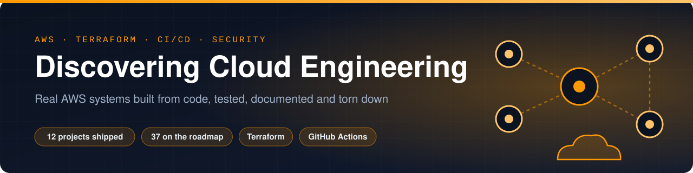
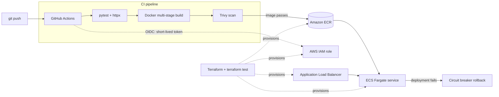
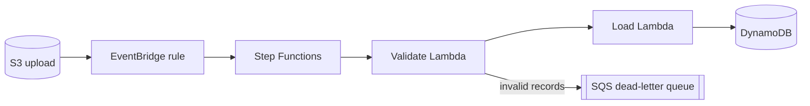
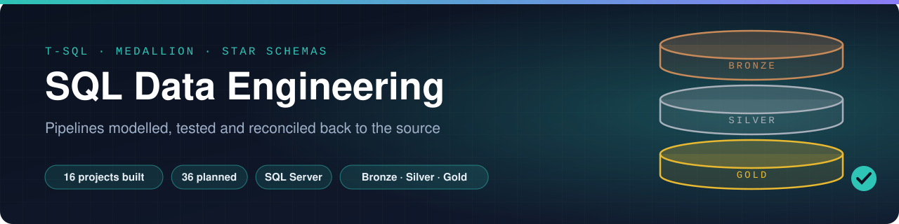
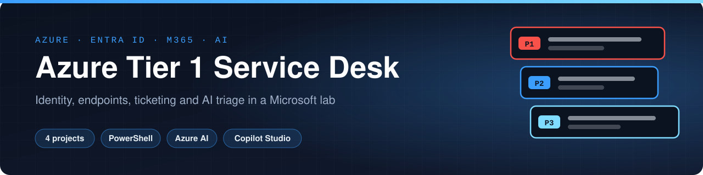
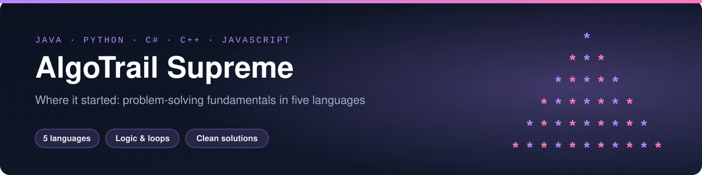

<h1 align="center">Hi, I'm Masego 👋</h1>
<h3 align="center">Cloud & DevOps Engineer · AWS · Azure · Terraform · SQL Data Engineering · ZA 📍</h3>

  

  
  
  

  <a href="#repos">Repositories</a> ·
  <a href="#principles">Principles</a> ·
  <a href="#skills">Skills</a> ·
  <a href="#stack">Tech Stack</a> ·
  <a href="#contact">Contact</a>

---

## 💫 About Me

I'm a Cloud & DevOps Engineer with a background in Systems Engineering, Information Systems, Computer Science and BI. I build cloud infrastructure entirely as code (Terraform), ship services through pipelines that test, scan and deploy on every push, and design for failure from the start: automated rollback, dead-letter queues, and audit logging are defaults, not extras.

Every project ships with what a production team would expect: an architecture diagram, **Architecture Decision Records (ADRs)**, a **runbook**, automated tests, and a **teardown script** so nothing is left running and costing money.

> *"I don't just write code — I deliver working, documented, operable systems."*

### 📈 At a glance

| ☁️ AWS projects shipped | 🗄️ SQL projects built & tested | 🎫 Azure service desk projects | 🧪 Every project |
|:-:|:-:|:-:|:-:|
| **12** (of 37 planned) | **16** (of 36 planned) | **4** | tests · ADRs · runbook · teardown |

---

## 🗂️ Featured Repositories

**[Discovering-Cloud-Engineering](https://github.com/masegoleroux-commits/Discovering-Cloud-Engineering)** · my flagship AWS portfolio. Each project is deployed from Terraform, tested, written up with lessons learned, then torn down to keep costs near zero.

- ✅ **Cloud Engineering (01–07):** S3 static site, serverless API, hardened VPC + EC2 with SSM (no SSH), ECS Fargate CI/CD with Trivy + OIDC, event-driven pipeline, security baseline
- ✅ **Networking (08–12):** Transit Gateway hub-and-spoke, NAT instance + Flow Logs, zero-internet VPC endpoints, Route 53 DNS Firewall, CloudFront + WAF high-availability web tier
- 🔨 **In progress:** Security & Identity (secret rotation, KMS key policies, GuardDuty threat detection), then Observability, Kubernetes, Automation and FinOps

<b>🔍 Deep dive: containerised API with secure CI/CD on ECS Fargate</b>

 

**Problem:** ship a container to AWS on every push without storing cloud credentials in CI, without letting vulnerable images reach production, and without a bad release taking the service down.

| Decision | Why |
|---|---|
| **OIDC federation** instead of IAM access keys | CI gets short-lived credentials per run; there is no secret to rotate or leak |
| **Trivy scan as a pipeline gate** | Vulnerabilities are caught before the image is pushed, not after it is running |
| **ECS Fargate** over EC2 | No servers to patch; the team manages tasks, not hosts |
| **Deployment circuit breaker** | A failed release rolls back automatically — verified and captured in screenshots |

📁 [View project, ADRs and runbook](https://github.com/masegoleroux-commits/Discovering-Cloud-Engineering/tree/main/cloud-pro_5/05-ecs-fargate-cicd)

<b>🔍 Deep dive: event-driven CSV data pipeline</b>

 

Processing starts when data lands (nothing runs while idle), Step Functions shows exactly where a run failed, and bad records go to a dead-letter queue for replay instead of being dropped. AWS calls are tested locally with **moto**.

📁 [View project](https://github.com/masegoleroux-commits/Discovering-Cloud-Engineering/tree/main/cloud-pro_6/06-event-driven-csv-pipeline)

 

**[SQL-Data-Engineering-Portfolio](https://github.com/masegoleroux-commits/SQL-Data-Engineering-Portfolio)** · 36 SQL projects across four tracks. Every pipeline runs Bronze → Silver → Gold into a star schema, and **stops at the first failed test** — row counts, orphan keys and totals are reconciled back to the source.

- ✅ **Core (6/6):** UEFA Champions League warehouse, SCD Type 2 history, a data quality framework, and query tuning on 2 million rows
- ✅ **Sports (10/10):** World Cup since 1930, NBA Elo, five-league JSON pipeline with a Poisson model, F1 points engine, 5 Hz match tracking data
- ⏳ **Next:** Banking (IFRS 9, AML monitoring, bank reconciliation) and AWS (Glue + Athena lake, Redshift Serverless, DMS change data capture)

 

**[Azure-Tier-Service-Desk](https://github.com/masegoleroux-commits/Azure-Tier-Service-Desk)** · hands-on service desk work in a Microsoft Azure lab (Windows Server 2022 domain controller, Entra ID, Microsoft 365).

| Project | What it shows |
|---|---|
| Service Desk Operations Lab | Joiner/mover/leaver automation, password resets and lockouts, MFA and SSPR, Exchange Online and Teams fixes, Group Policy |
| Remote Support & Ticketing | Remote PowerShell fixes, SLAs, ten well-written tickets, and a knowledge base deployed to Azure Static Web Apps via GitHub Actions |
| AI Service Desk Assistant | Copilot Studio agent grounded on the knowledge base; voicemail → ticket with Azure AI Speech + Azure OpenAI |
| Smart Ticket Triage | Ticket classification, sentiment, PII redaction and translation with Azure AI Language and Translator |

 

**[AlgoTrail_Supreme](https://github.com/masegoleroux-commits/AlgoTrail_Supreme)** · where it started: programming fundamentals and problem-solving exercises solved in Java, Python, JavaScript, C# and C++.

---

## 🏆 Highlights for Hiring Managers

- ✅ **Secure delivery pipeline** — test → build → Trivy scan → ECR → ECS Fargate, authenticated with OIDC (zero stored AWS credentials), with automatic rollback
- ✅ **Real network design** — Transit Gateway segmentation proved with Reachability Analyzer, workloads with no internet route, and DNS-layer blocking
- ✅ **Infrastructure tested like application code** — `terraform test` with mocked AWS, pytest + moto, and live PASS/FAIL scripts per project
- ✅ **Data you can trust** — SQL pipelines that reconcile to source and halt on a failed check
- ✅ **Microsoft stack too** — Entra ID, Microsoft 365, PowerShell and Azure AI services, not only AWS
- ✅ **Documented decisions** — ADRs, runbooks and an honest "lessons learned" for every project

---

## 🧭 Engineering Principles

| Principle | How it shows up in my work |
|---|---|
| **Everything as code** | All infrastructure provisioned with Terraform; no console click-ops. State and variable files are kept out of Git. |
| **Shift-left security** | Images scanned with Trivy in CI before they reach ECR. CI authenticates through **OIDC federation**, so no long-lived keys exist to leak. |
| **Design for failure** | Deployment circuit breakers roll back bad releases; bad records go to a dead-letter queue instead of being dropped. |
| **Test at every layer** | pytest, moto, httpx, native `terraform test`, and SQL reconciliation checks. |
| **Operability is part of done** | Runbooks, ADRs and architecture diagrams, so someone else can run it without me. |
| **Cost awareness** | Every environment has a teardown path; evidence is kept as screenshots. |

---

## 🎯 What I'm Working On

- 🔐 **AWS Security & Identity track:** secret rotation, KMS key policies, GuardDuty threat detection, Access Analyzer and ABAC
- 🏦 **SQL Banking & AWS tracks:** IFRS 9, AML monitoring and reconciliation, then Glue, Athena and Redshift
- ☁️ **Azure:** extending the service desk lab and porting my AWS patterns to Azure (Terraform + GitHub Actions OIDC)
- 📊 **Certifications:** **Microsoft PL-300**, with **DP-600** and **DP-700** (Microsoft Fabric) on the roadmap

---

## 💡 Core Skills

| Area | Tools & Technologies |
|---|---|
| **Cloud (AWS)** | Compute: Lambda, EC2, ECS Fargate · Networking: VPC, Transit Gateway, VPC endpoints, Route 53, CloudFront, ALB · Data: S3, DynamoDB, RDS · Events: Step Functions, EventBridge, SQS · Security: IAM (OIDC), KMS, Secrets Manager, WAF, CloudTrail, AWS Config, SSM |
| **Cloud (Azure & Microsoft)** | Entra ID · Active Directory · Microsoft 365 · Intune · Azure AI Language, Translator, Speech · Azure OpenAI · Copilot Studio · Power Automate · Static Web Apps |
| **Infrastructure as Code** | Terraform (modules, native `terraform test`, `terraform validate` in CI) · CloudFormation |
| **CI/CD & Containers** | GitHub Actions · Docker (multi-stage, non-root) · Trivy · OIDC federation |
| **Software Development** | Python (FastAPI, boto3) · T-SQL · Bash · PowerShell · C# · Java · C++ |
| **Testing** | pytest · moto · httpx · `terraform test` · SQL reconciliation tests |
| **Databases** | MS SQL Server · PostgreSQL · DynamoDB · MySQL · MongoDB |
| **Data & BI** | Medallion pipelines · star schemas · SCD Type 2 · pandas · scikit-learn · Power BI · Microsoft Fabric |
| **Engineering Practice** | ADRs · runbooks · draw.io diagrams · ITSM, SLAs and ticket writing |

---

## 💻 Tech Stack

**Cloud, IaC & DevOps**

**Languages & Frameworks**

**Testing**

**Data & AI**

**Databases**

**Version Control & Project Management**

---

## 🤝 Let's Work Together

I also take on **freelance projects**:

- ☁️ **AWS & Azure infrastructure as code** — Terraform-managed environments that are reproducible and reviewable
- 🔁 **CI/CD pipelines** — GitHub Actions with automated tests, image scanning, and keyless (OIDC) cloud deployments
- 🔄 **Event-driven data pipelines** — serverless ingestion, validation, and loading with failure handling built in
- 🛡️ **Cloud governance baselines** — audit logging and compliance rules from day one
- 🗄️ **SQL data pipelines** — tested medallion pipelines and star schemas that reconcile to source
- 📋 **Project delivery** — requirements, architecture, ADRs, runbooks, and handover documentation

No jargon, no fluff — just working, documented systems your team can operate.

📧 **[mashigokk@outlook.com](mailto:mashigokk@outlook.com)** · 💼 **[LinkedIn](https://linkedin.com/in/masego-mashigo-68a1b3240)**

---

## 😄 A Bit About Me

- 🏟️ I build projects on **real sports datasets** — because tech is more fun when you care about the subject
- 🚀 I love the moment a pipeline runs green end-to-end for the first time
- 🌍 Based in **Johannesburg** (SAST, UTC+2) — working with teams locally and remotely across Africa and beyond
- 📚 I believe the best engineers are the ones who **never stop asking "why?"** — that's what ADRs are for

---

## 📊 GitHub Stats

---

  <i>Open to Cloud Engineer · DevOps Engineer · Software Developer · AI Software Engineer roles · Johannesburg or Remote</i>

