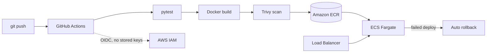

<h1 align="center">Hi, I'm Masego 👋</h1>
<h3 align="center">Cloud & AI Software Engineer · DevOps · ZA 📍</h3>

  

  
  

---

## 💫 About Me

I'm a Cloud & AI Software Engineer with a background in Systems Engineering, grounded in Information Systems and Computer Science, and a foundation in data analytics and BI. I design, build, automate, and deploy systems end-to-end — from defining requirements and architecture, to writing clean Python and SQL, to provisioning AWS infrastructure with Terraform, integrating AI into real products, and shipping them through reliable CI/CD pipelines.

Systems engineering taught me to see the whole picture: how components, people, and processes fit together, and how to design solutions that are reliable, scalable, and easy to maintain. My data background means I think in terms of outcomes — every system I build should produce something people can trust and act on. I also bring a project management mindset: planning clearly, managing the full system lifecycle, owning delivery, and communicating progress in plain language to technical and non-technical stakeholders alike.

> *"I don't just write code — I deliver working solutions."*
>
> 👉 **See the proof:** six AWS projects built end-to-end with Terraform, tests and CI/CD in **[Discovering-Cloud-Engineering](https://github.com/masegoleroux-commits/Discovering-Cloud-Engineering)**

---

## 🎯 What I'm Working On

- ☁️ Growing my **cloud engineering** skills — six AWS projects shipped, now bringing the same patterns to **Azure**
- 🤖 Building **AI-powered applications** and learning to deploy and monitor models in production (MLOps)
- 🔁 Automating build, test, scan, and deployment with **GitHub Actions CI/CD pipelines**
- 📊 Building toward **Microsoft PL-300**, with **DP-600** and **DP-700** (Microsoft Fabric) on the roadmap
- 🏗️ Building end-to-end projects on real sports and business datasets

---

## 💡 Core Skills

| Area | Tools & Technologies |
|---|---|
| **Software Development** | Python (FastAPI, boto3) · C# · Java · C++ · HTML5 · SQL · Bash |
| **Cloud Engineering** | AWS (S3, Lambda, API Gateway, DynamoDB, VPC, EC2, ECS Fargate, ECR, Step Functions, EventBridge, SQS, CloudTrail, Config, IAM) · Azure (Data Factory, Synapse) · Microsoft Fabric |
| **Infrastructure as Code** | Terraform (including `terraform test`) |
| **DevOps & Automation** | GitHub Actions · Docker (multi-stage builds) · Trivy image scanning · OIDC to AWS · Git · GitHub · Bitbucket |
| **Testing** | pytest · moto · httpx |
| **AI & Data Engineering** | Python (pandas, scikit-learn) · Apache Airflow · ETL pipeline design |
| **Databases** | MS SQL Server · DynamoDB · PostgreSQL · MySQL · MongoDB · Firebase |
| **BI & Visualisation** | Power BI (DAX, semantic modelling, report design) |
| **Project Management** | End-to-end delivery · requirements gathering · ADRs & runbooks · stakeholder communication |

### 🚀 Currently Expanding Into
Azure (rebuilding my AWS projects on Azure) · Kubernetes · LLM integration · Agile/Scrum with Jira

---

## 🏆 Highlights for Recruiters

- ✅ **Full lifecycle ownership** — every project goes from architecture and ADRs, through build and tests, to a runbook and a teardown script
- ✅ **Cloud + code + data** — six AWS projects in Terraform, Python services with tests, and SQL Server analytics work
- ✅ **Secure CI/CD** — pipelines that test, build, scan with Trivy, and deploy to ECS Fargate using OIDC (no stored AWS keys)
- ✅ **Delivery-focused** — I plan, prioritise, and communicate progress like a project manager, not just a developer
- ✅ **Currently available** for Cloud Engineer, DevOps Engineer, Software Developer, and AI Software Engineer roles in Johannesburg or remote

---

## 🗂️ Featured Projects

> ✅ *All six projects below are built and documented, each with its own architecture notes, runbook, and screenshots, in **[Discovering-Cloud-Engineering](https://github.com/masegoleroux-commits/Discovering-Cloud-Engineering)**.*

---

### 🚢 Containerised API with Secure CI/CD on ECS Fargate
A FastAPI service packaged in a multi-stage Docker image. Every push runs pytest, builds the image, scans it with Trivy, pushes to ECR, and deploys to ECS Fargate behind a load balancer. GitHub Actions signs in to AWS with OIDC, so no long-lived keys are stored, and the ECS circuit breaker automatically rolls back a failed release.

**Tools:** Python · FastAPI · Docker · Trivy · GitHub Actions · AWS (ECS Fargate, ECR, ALB, IAM) · Terraform

> 📁 *[View project](https://github.com/masegoleroux-commits/Discovering-Cloud-Engineering/tree/main/cloud-pro_5/05-ecs-fargate-cicd)*

---

### 🔄 Event-Driven CSV Data Pipeline
A serverless pipeline: a CSV dropped into S3 triggers EventBridge, which starts a Step Functions workflow that validates and loads the data with Lambda into DynamoDB. Bad records go to an SQS dead-letter queue instead of being lost.

**Tools:** AWS (S3, EventBridge, Step Functions, Lambda, DynamoDB, SQS) · Python · pytest · moto · Terraform · GitHub Actions

> 📁 *[View project](https://github.com/masegoleroux-commits/Discovering-Cloud-Engineering/tree/main/cloud-pro_6/06-event-driven-csv-pipeline)*

---

### ⚡ Serverless Notes API
A REST API built on Lambda, API Gateway, and DynamoDB in Python, with a pytest suite and a CI pipeline that runs tests and `terraform validate` on every push.

**Tools:** AWS (Lambda, API Gateway, DynamoDB) · Python · pytest · Terraform · GitHub Actions

> 📁 *[View project](https://github.com/masegoleroux-commits/Discovering-Cloud-Engineering/tree/main/cloud-pro_3)*

---

### 🛡️ More AWS Builds

- **VPC + Hardened Web Server** — custom network design, EC2 hardening, and SSM access with no open SSH · [View](https://github.com/masegoleroux-commits/Discovering-Cloud-Engineering/tree/main/cloud-pro_4)
- **AWS Security Baseline** — CloudTrail logging and AWS Config compliance rules, with real non-compliance findings captured · [View](https://github.com/masegoleroux-commits/Discovering-Cloud-Engineering/tree/main/cloud-pro_7)
- **Static Website on S3** — S3 hosting provisioned with Terraform · [View](https://github.com/masegoleroux-commits/Discovering-Cloud-Engineering/tree/main/cloud-pro_1)
- **UCL 2021/22 SQL Analysis** — SQL Server scripts analysing Champions League data · [View](https://github.com/masegoleroux-commits/SQL_Boulevard)

---

### 🔜 Coming Next

- 📊 **Sports Analytics & AI Platform** — PostgreSQL warehouse, scikit-learn models, and Power BI dashboards for coaching, sports science, scouting, and commercial teams
- ☁️ **Cloud Business Reporting Solution** — SQL Server → Azure Data Factory → Power BI semantic model with automated daily refresh
- 🔄 **Airflow ETL Pipeline** — daily CSV loads into PostgreSQL with data quality checks, Docker, and GitHub Actions

---

## 💻 Tech Stack

**Languages**

**Cloud & DevOps**

**AI & Data**

**Databases**

**Version Control & Project Management**

---

## 🤝 Let's Work Together

I also take on **freelance projects**. I can help with:

- ☁️ **Cloud solutions** — setting up and automating infrastructure on AWS with Terraform
- 💻 **Software & automation** — Python tools, APIs, and scripts that save time
- 🔁 **CI/CD pipelines** — automated testing, security scanning, and deployment with GitHub Actions
- 🔄 **Data pipelines** — automated ingestion, validation, and loading
- 📋 **Project delivery** — planning, coordinating, and seeing tech projects through to launch

No jargon, no fluff — just working solutions your team will actually use.

📧 **[mashigokk@outlook.com](mailto:mashigokk@outlook.com)** · 💼 **[LinkedIn](https://linkedin.com/in/masego-mashigo-68a1b3240)**

---

## 😄 A Bit About Me

- 🏟️ I build projects on **real sports datasets** — because tech is more fun when you care about the subject
- ☕ My best code is written after a strong cup of coffee
- 🚀 I love the moment a pipeline runs green end-to-end for the first time
- 🌍 Based in **Johannesburg** (SAST, UTC+2) — working with clients locally and remotely across Africa and beyond
- 📚 I believe the best engineers are the ones who **never stop asking "why?"**

---

## 📊 GitHub Stats

---

## ✍️ Random Dev Quote

---

## 🔝 Top Contributed Repos

---

  <i>Open to Cloud Engineer · DevOps Engineer · Software Developer · AI Software Engineer roles · Johannesburg or Remote</i>

